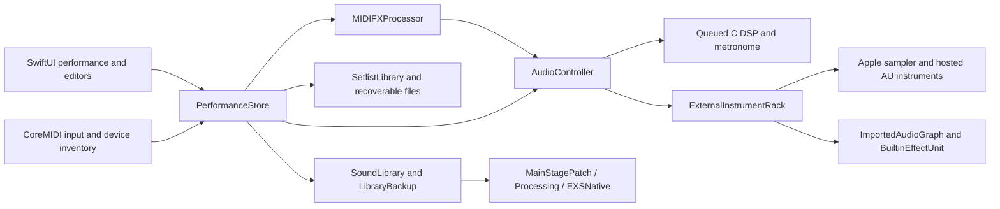

# Current-state audit

Research baseline: 2 November 2026, commit `6a253130196e8beca471a575a45c1834d52cedf8`; remote main matched the checkout. Working tree was clean at entry. This audit adds planning documents only. No feature implementation, issue mutation, signing, installation or distribution is authorized by this record.

## Executive assessment

StageKeys has a substantial independent performance, conversion and audio implementation with reproducible synthetic regression coverage. It is not qualified for a public live-performance reliability or blanket MainStage/Sunday Keys compatibility claim. The main remaining work is failure-safe graph transitions, qualification of supported content/plugins/devices, persistence coverage and release evidence. Rebuilding implemented browsers, MIDI setup or import transactions would waste existing work.

Evidence vocabulary: **VERIFIED** means this session inspected code/metadata or executed the named check, with its scope stated. **DOCUMENTED** means a repository record or issue reports prior observations, not repeated here. **INFERRED** means an engineering interpretation needing a reproduction. **UNKNOWN** means unavailable or unexamined. Implementation status and verification confidence are separate.

## Architecture and ownership

`StageKeysApp` owns one `PerformanceStore` StateObject. SwiftUI views use the store for selection, editing, live preview and persistence. `Models`, `ChannelSettings`, `MIDIPrograms` and `SessionSettings` hold Codable value state. `PerformanceStore` coordinates MIDI, audio, library conversion and saves; its roughly 1,800 lines make cross-feature state changes a review hotspot, not grounds for a rewrite.

Audio graphs use AVAudioEngine, Apple instruments and independent C effects. The C queue is bounded, with emergency handling on overflow. Graph edits are serialized on main, batch engine stops and restore active samplers/controllers. This avoids graph construction inside the render callback, but it does not establish atomic rollback or bounded UI stalls. Input MIDI is dispatched to main; arp/sequencer timing uses a 5 ms main-run-loop timer. The design cannot currently promise sample-accurate musical scheduling under UI load.

## Feature inventory

All paths below are relative to repository root; names identify exact inspection/test entry points. High confidence means the stated bounded fact is code-supported, not production-qualified.

| Subsystem | Current status | Evidence and affected files | Confidence | Outstanding work / owner |
| --- | --- | --- | --- | --- |
| Sample-free first launch | Implemented | `Sources/Models.swift`, `SoundBrowser.swift`, `Store.swift`; `NoFactorySoundsTests`; README/FIRST-RUN | High | Preserve blank 15-slot/five-snapshot startup; #89 closed |
| Rack/layers/patches | Implemented core, qualification partial | `PerformanceControls.swift`, `Store.swift`; `AllSoundSlotsTests`, `StoreTests` | High for model | Sustained transitions, each editor lifecycle, real window/device UI; #16/#19 |
| Snapshot positions and notes | Implemented; product-contract conflict | `Models.SnapshotSoundState`, `Store.recall`, `SnapshotMorph.swift`; `SnapshotSlotTests` | High | Captures FX parameters, MIDI programs, pan/AU state beyond manual's bypass/level/wheel subset; resolve #16 before migration |
| Tonic Pad | Sampler selection and transactional audition implemented; AU pad disabled | `Store.tonicEligibility/loadTonicSound`, `PatchWorkflowViews.swift`; `TonicPadTests`; TONIC-PAD-LIBRARY | High | Physical sustained-pad behavior and lock/cancel paths; #16; do not infer AU pad support from #54 closure |
| MIDI connections/ownership | Implemented core | `MIDIInput.swift`, `ExternalMIDIOutput.swift`, `Store.handleMIDI`; setup/plug-and-play/input/external tests | High synthetic | Keyboard boot capture #88; hardware hot-plug/pedals/bend/expression #3/#15 |
| MIDI FX | Four independent processors implemented | `MIDIPrograms.swift`, `MIDIFXProcessor.swift`, `Editors.swift`; MIDIFX/Groove tests | High | Main-thread timing, mapping/range details and load jitter #11/#15/#111 |
| Transpose/tempo lock | Implemented, validation partial | `MIDIPrograms.PatchTransposition`, `Store.updateTempo`, `SessionSettings`; `PatchTranspositionTests`; PR #125 | High | Sample timing, conversion/export and live sustain; #111 |
| Instrument ADSR/filter/order | Native synth path implemented; sampler/AU qualification partial | `Synth.c`, `ChannelSettings.swift`, `SoundSettingsControls.swift`; NativeSoundOrder/ChannelSignalOrder tests; PR #126 | High | Imported graph uses a different chain; native synth is not a shipped voice; #112 |
| Effects | Active independent implementations; fidelity partial | `Synth.c`, `CreamCoat.c`, `ShimmerPitch.h`, `BuiltinEffectUnit.swift`, `AudioEffectParameters.swift`; sanitizer suite | High implementation | Matched reference listening/tapers/CPU budgets; #9/#10/#11 |
| Graph transitions/tails | Bounded tail retirement implemented; failure safety incomplete | `ExternalInstruments.editGraph/finishGraphChanges/enqueueRetiredTail`; GRAPH-TAILS; ExternalGraphTail tests | High code | Two tails/20 s are policy bounds, not measured budgets; restart/rollback #123; live/AU #55 |
| Audio startup/devices | States, classification, retries and output selection implemented | `AudioController.swift`, `AudioDevices.swift`, `Store.attemptAudioStart`; AudioStartup tests; PR #117 | High for logic | Actual AudioBox contention/unplug/sleep reproduction #110; graph errors #123 |
| Output protection/meters | Main mix limiter and post-output meter implemented | `AudioController.init/installOutputTap`; `OutputMeterTests` | High topology | Metronome enters protectedOutput after limiter; combined peak bound unmeasured; #3/proposal N02 |
| Diagnostics/audio check | Local allowlisted report and bounded 30 s capture implemented | `AudioDiagnosticRecorder.swift`; recorder/support tests | High | `append` takes NSLock and allocates PCM buffers on tap callback; timing impact unmeasured; #4/proposal N01; underrunCount remains nil |
| Native sampler/EXS | Supported subset implemented; unsupported modes explicit | `EXSNative.swift`, `StageKeysSampler.swift`, `EXSCaptureCompatibility.swift`; modern/legacy synthetic tests | High subset | Real-source corpus, response and rejected release/crossfade/round-robin modes #2/#7 |
| MainStage import | Preflight, discovery, bookmarks, per-channel outcomes, ready-only assembly | `MainStagePatch.swift`, `Store.swift`, `SoundImportView.swift`; guided/preflight tests; PR #124 UI | High subset | Whole concerts/folders/multi-instrument topology, missing-content repair coverage #5/#6; #85 closure needs reconciliation |
| MainStage processing | Visible source-effect selection and instrument EQ/comp mapping | `MainStageProcessing.Draft`, `MainStageSourceRecord`; effect-selection tests; PR #118 | High | Macros/MIDI omissions are archived; sends/buses not translated; #6/#10, not complete #52 parity |
| Library/tags/ratings | Implemented model and add/replace workflows | `SoundLibrary.swift`, `LibraryBrowserModel.swift`, `SoundBrowser.swift`; browser/range/rating/recovery tests; PR #119 | High model | Layout, accessibility and missing content qualification #17/#19 |
| Portable sound packs | Writer/reader/hash/path/bounds/eligibility and UTType implemented | `LibraryBackup.swift`, Info plists; PersonalSoundPack/LibraryBackup tests | High software | Physical iPad deferred #105; no setlist/cloud equivalence implied |
| AU hosting/editors | AUv2/AUv3 foundation, state/generic editor and stale callback guards | `ExternalInstruments.swift`, `PluginInterface.swift`, `PluginParameterModel.swift`; #27/#94; catalog/parameter/recovery tests | High logic | Real custom/generic matrix #12/#53; AUv2 in-process, main-thread hangs #13; physical mobile #14 |
| Session/metadata persistence | Atomic individual writes and validated previous-copy recovery implemented | `SetlistLibrary.swift`, `Store.swift`, `SessionSettings.swift`, ratings/presets archives | High bounded | Cross-file consistency, complete migrations, undo, clean restore #20; no whole-session transaction guarantee |
| Flex Routing | Missing multi-output implementation; explicit UI limitation | `SettingsViews.swift` Flex Routing; `ChannelSettings.routingGroup` metadata | High | Device/category/per-sound bus graph #107; needs architecture before preload |
| Metronome | Implemented settings and C click/accent engine | `Synth.c` metronome; `SessionSettings.MetronomeSettings`; metronome tests; PR #116 | High | Combined limiter path, route and long clock qualification #3/#107; toolbar still hardcodes 4/4 |
| Mobile background | Partial and conflicts with continuity goal | `StageKeysApp` scenePhase panics on non-active iOS; Store interruption handler always stops; project has audio background mode | High code | Explicit policy/state machine/recovery #113, physical #105 |
| Portable setlist templates/sharing | Local setlist create/duplicate/Trash/file export exists; larger request partial | `SetlistLibrary.swift`, `PatchWorkflowViews.swift`, `Store.swift` | Medium | #114 versioned dependency/identity package; hosted links optional |
| Cloud backups / AI | No CloudKit implementation found; AI local draft schema only | source search, `Models.PatchDraftPlan`; INDEPENDENT-PATCH-BUILDER | High absence in tracked source | #121 conflicts with earlier cloud exclusion; #24 later; owner scope decision |
| CI/artifact/provenance | Implemented automated baseline | `.github/workflows/distribution.yml`, `Tools/verify-release.sh`, distribution/icon/pack gates | High | Latest hosted runs are snapshots; checks do not prove physical/sonic/signing gates #4/#21 |
| Licensing/public distribution | Unqualified | No root LICENSE; component notices remain scoped; public-mac verifier exists | High file fact | #64 closed without visible decision in issue; owner must record scope; #21 signing/install/update/rollback |

## Significant contradictions and risks

1. `Docs/PARITY-STATUS.md`, CONVERSION-STATUS and older milestone notes are chronological history. Old claims about missing snapshots, EQ layouts, native exports, bookmarks, no tail pool and archive-only Tape Delay are superseded by current code. Keep historical evidence; add current pointers rather than silently rewriting observations.
2. Closed #8 still has comments explicitly leaving checkpoints/batch resume open; closed #85 still leaves whole-concert/folder and multi-instrument work. Seek a retained follow-up scope or approved reopening, not automatic closure/reopening. #87 has an explicit owner-approved physical transfer to #105 and should remain closed for software scope.
3. #1 closed does not prove all original velocities/pedal/chord acceptance. Its body remains unchecked and this session's private reference tests skip. #64 closure does not establish a selected license. These are evidence requests, not grounds to infer completion or owner intent.
4. #16's latest manual-derived comment says only levels/bypass/wheel belong in snapshots. Current serialization and recall include much more. Changing that behavior could destroy user-authored snapshots. Resolve and version a contract first.
5. #112's native C order is compressor → filter → EQ. The hosted/imported chain currently passes filter → EQ → compressor → imported processing → builtin slots → mixer. Treat it as a code-supported difference pending source-intent and audible validation, not automatic parity failure.
6. Graph batches restore sampler/mixer state and restart on error; they do not retain a full previous graph for general rollback. #123's intermittent -1 root cause remains unknown. Tail preservation is not error atomicity.
7. `AudioDiagnosticRecorder.append` locks, allocates a new PCM buffer, and enqueues a closure per tap buffer. Background file writing alone does not satisfy a no-allocation/no-lock callback requirement. Callback scheduling/deadline impact must be measured before claiming an underrun.
8. `Store.handleMIDI` accepts Primary OR Secondary once, then dispatches both through the same note/CC/Program Change cases. This contradicts #15's latest manual-derived Primary-only-notes requirement. The same switch has no pitch-bend dispatch, and MIDIControlTarget has no tonic brightness/shimmer or effect bypass/parameter targets. These are confirmed source gaps owned by #15/#3, not newly reproduced hardware defects.
9. The single-file import path copies and loads arbitrary selected audio without a file-size admission bound in `ExternalInstruments.importSound`; #79 comments explicitly warned that `.sample` residency holds the entire file. Set an approved memory/admission policy under #2/#109, measure decoded cost rather than relying only on compressed bytes, and preserve the continuity fix.
10. `PianoHeldNoteTests` returns success without a SKIP marker when its fixture is unset. Runner results therefore include one additional unexercised program in the 88 pass statuses; see N06.
11. The click connects directly to `protectedOutput`, while the main mix passes `outputLimiter`. The combined signal has 1 dB output scaling but no demonstrated post-sum bound. This is a structural test gap, not a measured clipping report.

## Verification and scope

See [evidence ledger](EVIDENCE.md) and machine-readable [verification record](verification.json) for exact commands, results, hashes and limitations. Initial sandbox builds failed because SwiftUI macro helper sandboxing was prohibited; the initial audio test aborted under restricted Apple service access. Those are retained environment failures, not product regressions or passing tests. Normal-service retries are recorded separately.

Current-session evidence does not include an eight-hour soak, physical keyboard latency, source piano comparison, reference listening, physical mobile execution, signed/notarized install, or all third-party plugins. No lint tool is configured as a distinct gate; the existing Python policy checks and compiler diagnostics are used. Apple SDK deprecation warnings on Xcode 27.2 deserve a future compatibility assessment, not an unrequested API rewrite.

## Investigation coverage and continuation

Read README/AGENTS/release gates, current compatibility documents, deep UI audit, recovery/platform/graph/transpose/order/import/provenance notes, prior PR-history review, affected test runners/workflow, all 51 issue bodies and discussions, and current/relevant PR descriptions. Inspected principal state, graph, MIDI, model, persistence, conversion and diagnostic entry points. The coverage inventory in `evidence-inventory.json` records tracked document/source/test paths for follow-up; inclusion is an inventory, not a claim that every line was reviewed.

Not performed: line-by-line review of every source/test, every historical PR diff/review discussion, all older calibration JSON remeasurement, exhaustive live reference menu actions, or private library repository audit. StageKeys-Library issues #1–#3 are linked but not independently reviewed here. Continue with the bounded sessions in the reference matrix and roadmap rather than treating this audit as exhaustive runtime certification.
