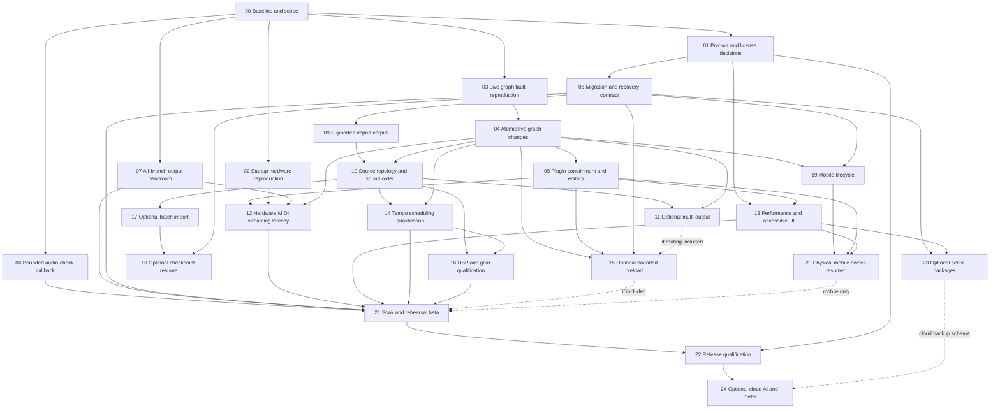

# Dependency map

Edges express proposed engineering prerequisites, not GitHub dependency mutations. Existing release umbrellas remain open. Conditional nodes are scope choices; the roadmap task table is the full acceptance/validation source.

## Cross-cutting constraints

- #123 graph transactions precede new graph features #107/#109. A safe tail pool (#55) is compatible work but not a substitute for rollback.
- #20 serialization/recovery precedes new backup/checkpoint/share formats. A local atomic file write is not atomicity across every state file or a cloud restore.
- #6 source topology precedes faithful multi-instrument decomposition and DSP path comparisons. Match processor order and gain before interpreting a null/residual measurement.
- #16 snapshot contract precedes data migration or edits that assume only bypass/levels. Preserve existing full captured state until an approved versioned decision exists.
- #13 plugin containment and real state/editor matrix precede preload of arbitrary third-party components. A main-queue timeout cannot contain a blocked main queue.
- #105 is deferred by owner request. No task here resumes it automatically. A Mac-only release can qualify separately; public mobile qualification still needs actual physical evidence.
- #64 is an owner decision, not a dependency on choosing any particular license. Public distribution needs an explicit record and component/provenance review, not a guessed MIT label.

## Safe parallelization boundaries

| Workstream | Can overlap | Shared-state constraint |
| --- | --- | --- |
| Graph failure diagnosis/rollback | Recorder and persistence analysis | One owner for ExternalInstruments/AudioController/Store graph paths |
| Recorder callback transport | Graph diagnosis | Isolate AudioDiagnosticRecorder changes; coordinate tap interface with graph owner |
| Persistence/migrations | DSP measurement and UI observation | One owner for Models/SessionSettings/Store persistence fields |
| Reference UI observation | All implementation analysis | Read-only/disposable state; retain license and action logs |
| DSP render measurement | UI/accessibility evidence | Freeze source/processor/gain identities; no overlapping unreviewed DSP mutations |
| Device measurements/soak | Documentation and provenance | Frozen tested binary, owned rigs and settings; invalidate evidence when audio inputs change |

These are opportunities for future explicitly approved delegation. This audit did not run parallel model agents. Tests/builds were independent processes against unchanged sources.
